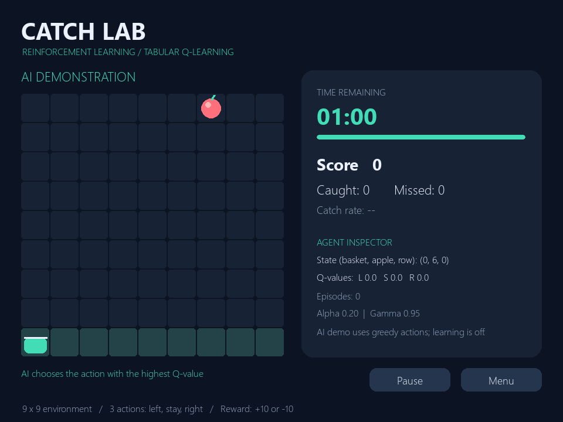

# Catch Lab — Q-Learning Project

**A playable reinforcement-learning assignment: catch apples yourself, train a tabular Q-learning agent, and watch its decisions improve.**

The project includes a Python/Pygame desktop game and a responsive browser game. Both implement the same environment and Q-learning update. The browser version runs entirely on the client—no server, API keys, or build step needed.

## Features

- Human play with arrow keys or A/D; on-screen touch controls in the browser.
- Selectable **30-, 60-, or 90-second rounds**, pause, restart, score, and round results.
- Real **epsilon-greedy tabular Q-learning**, with 30,000-episode training batches.
- AI demonstration mode and live left/stay/right Q-value inspection.
- Browser learning curve, saved training progress, and JSON model export.
- Automated checks for game rules, terminal updates, learning improvement, and desktop timer behavior.

## 1. Get the project

```bash
git clone https://github.com/Roshanzha/Q-Learning.git
cd Q-Learning
```

## 2. Run the browser game

Open **`docs/index.html`** in a modern browser, or serve it locally:

```bash
python -m http.server 8000 --directory docs
```

Visit **http://localhost:8000**. A local server is recommended for consistent browser storage behavior. This version requires no Pygame or Node installation. Google Fonts improves the appearance when online; fallback fonts and the game work without it.

### Play manually

1. Choose **You play**.
2. Select a round duration, then click **Start a round**.
3. Hold **← / →** or **A / D** to move the basket. On touch screens, hold the direction buttons.
4. Catch an apple for **+10**; a miss costs **10** points.
5. Use **P** or the Pause button to pause; **R** or Restart starts a new round. The browser also pauses gameplay when you switch tabs.

### Train and demonstrate the AI

1. Click **Train agent** for 30,000 episodes. Training occurs in short batches so the page stays responsive.
2. Follow the learning curve, episode count, and declining exploration rate.
3. Select **AI plays**, then **Start a round**.
4. Watch the Q-values change with the current state and compare the agent's catch rate with your own.
5. Train again to continue learning, or stop a batch and retain its progress.

The browser stores the Q-table locally when storage is available. **Export model** downloads the table, hyperparameters, and training history as JSON. **Reset learning** clears the learned policy after confirmation. Importing a model is not currently supported. Different browsers and site origins have separate saved progress.

## 3. Run the Python desktop game

Python **3.12** is the tested version. Create an environment and install Pygame:

**Windows PowerShell**

```powershell
python -m venv .venv
.\.venv\Scripts\python.exe -m pip install -r requirements.txt
.\.venv\Scripts\python.exe play_catch.py
```

**macOS / Linux**

```bash
python3 -m venv .venv
.venv/bin/python -m pip install -r requirements.txt
.venv/bin/python play_catch.py
```

Select **Play yourself**, or **Train AI (+30,000)** followed by **Watch AI**. Hold arrow keys or A/D to move; **P** pauses, **R** restarts, and **Esc** returns to the menu. Desktop training progress is held in memory and resets when you close the application.



## 4. How Q-learning works

| Component | Definition |
| --- | --- |
| Environment | A 9 × 9 grid containing one falling apple and a basket |
| State | `(basket column, apple column, apple row)` |
| Actions | `0 = left`, `1 = stay`, `2 = right` |
| Transition | Move the basket one cell (clamped at the edge), then drop the apple one row |
| Reward | `+10` for a catch, `−10` for a miss, `0` for intermediate steps |
| Episode | One apple, ending after 8 steps when it reaches the bottom row |
| Reset | Both basket and apple columns randomize at the start of every episode |
| Learning rate | `α = 0.20` |
| Discount factor | `γ = 0.95` |
| Exploration | `ε = 1.0`, multiplied by `0.9998` after each episode, minimum `0.03` |
| Game speed | One action and falling step every `0.20` seconds |

The Q-table starts at zero. During training, the agent selects a random action with probability ε; otherwise it chooses an action with the highest Q-value. Ties are broken randomly.

```text
Q(s, a) ← Q(s, a) + α × [target − Q(s, a)]

target = reward                              if the episode ended
target = reward + γ × max Q(next_state, a')  otherwise
```

No hardcoded apple-following rule is used. The agent learns which actions lead to catches from rewards alone. Terminal transitions do not include a future value. AI demonstrations use greedy actions with learning turned off.

The round timer is separate from the RL episode: a timed round contains multiple apples. Training does not use the round timer. The learning chart reports catches in groups of **500 exploratory training episodes**, so its rate can be lower than greedy evaluation accuracy.

## 5. Tests and measured results

**Python**

```powershell
.\.venv\Scripts\python.exe -m unittest -v test_catch.py
.\.venv\Scripts\python.exe play_catch.py --evaluate
```

On macOS/Linux, use `.venv/bin/python` instead. The tests use SDL's dummy drivers for headless rendering.

**Browser algorithm** — requires Node.js (tested with v21.4.0):

```bash
node tests/test-learning.cjs
```

Measured seeded evaluation after **30,000 training episodes**, with **2,000 evaluation episodes** per policy:

| Implementation | Random actions | Trained greedy policy |
| --- | ---: | ---: |
| Python | 11.2% catches | 100.0% catches |
| JavaScript | 11.8% catches | 100.0% catches |

These are results on this small environment with fixed test seeds, not guarantees for every training run or a more complex game. Browser interactive training uses `Math.random()` and can vary. The Python suite also checks pause, timer expiry, restart, rewards, boundaries, and screen rendering; the JavaScript suite checks rewards, boundaries, terminal learning, serialization, and improvement over random actions.

## 6. Host the browser game

### GitHub Pages

The `docs/` folder is ready for GitHub Pages:

1. Open the repository's **Settings → Pages**.
2. Under **Build and deployment**, select **Deploy from a branch**.
3. Choose branch **main** and folder **/docs**, then Save.
4. Wait for the Pages deployment to finish, then open the URL shown in Settings.

The expected project URL is `https://roshanzha.github.io/Q-Learning/`. It becomes live only after Pages is enabled and deployment succeeds.

### Other static hosts

Upload the contents of `docs/` to a static host. Set the publish directory to **docs** if the service connects directly to this repository; leave the build command empty. `index.html` must be at the root of the published directory. Asset paths are relative, so subdirectory hosting is supported. No backend or environment variables are needed.

## Project structure

```text
Q-Learning/
├── README.md               # Setup, algorithm, evaluation, and hosting guide
├── requirements.txt        # Pygame dependency
├── play_catch.py            # Desktop game, environment, Q-agent, evaluation
├── test_catch.py            # Python tests
├── docs/                   # Deployable browser game / GitHub Pages root
│   ├── index.html          # Game interface and algorithm notebook
│   ├── style.css           # Responsive styling
│   ├── learning.js         # Environment and tabular Q-learning
│   ├── app.js              # Game loop, timer, training UI, persistence
│   └── .nojekyll
├── tests/test-learning.cjs  # JavaScript learning tests
└── assets/                 # Documentation screenshots
```

## Suggested assignment presentation

1. Explain the problem, state, actions, rewards, and terminal condition.
2. Play one manual timed round.
3. Show an untrained agent, then train for 30,000 episodes.
4. Explain exploration versus exploitation using the epsilon value and chart.
5. Demonstrate the trained policy and inspect Q-values.
6. Report the seeded comparison with random actions and discuss the environment's limitations.

## Troubleshooting

- **Pygame is missing:** run the dependency installation using the same Python interpreter you use to launch the game.
- **Arrow keys scroll the page:** click the game area, then use the arrow keys or touch buttons. Leave the duration dropdown before playing.
- **AI is unreliable:** finish a training batch before demonstrating the policy.
- **Progress disappeared:** browser storage is specific to the browser and site origin; private browsing or clearing site data can remove it. Export a copy when needed.
- **Pages returns 404:** verify the `main` → `/docs` source and check the repository's Pages deployment status.
